## Problem

The owner console stacks everything a page could do onto one scroll. Data, forms, tutorials and danger zones share the same column, so the thing you came for is rarely in the first viewport.

Measured on `main` (ee60d4f) in demo mode at 1440x900:

| Page | What is wrong |
| --- | --- |
| Project overview | 4,576px tall. `Project.cshtml` has 12 `<form>`s and 45 inputs, selects and textareas: settings, security, player keys, projections, revision policy (16 fields), key permissions inside `
`, archive, typed delete. The `NetworkStorage.Configure` line, the most copied thing on the page, sits under two notices. |
| Collection records | 4.5 rows above the fold, 1 row on mobile. Each row is about 107px because the JSON preview wraps. No selection, no bulk actions, no collection size, keys not copyable. |
| Projects | One project card, then three tutorial sections (Connect a game, Author your first backend, Use with a coding agent): 2,386px. |
| Record | Typed-confirmation delete form inline under the JSON editor. |
| Shell | Topbar renders about 128px tall. The Discord link in `_Layout.cshtml:122` has no CSS rule (`.topbar-links`, `.discord-link`, `.discord-icon` are unstyled), so its 24x24 SVG scales to about 70px. This is a bug on `main` independent of the redesign. |

| Collection today | Mobile today | Project page today (full height, scaled) |
| --- | --- | --- |
|  |  |  |

## Proposal

A new design system for the console and sboxns.com, written up in [`DESIGN.md`](DESIGN.md). It replaces `docs/ui-guidelines.md`.

- **Layout:** one intent per page, no inline forms, toolbar actions, copy chips, layered list, sheet, page and modal, iOS-style mobile.
- **Themes:** System, Dark (near-black), Light (white) and High contrast. The five hue-variant themes are retired, and stored keys map forward.
- **Surfaces:** content is outlined, controls are filled, and only overlays are raised. Sticky bars blur.
- **Shape and icons:** a 4 to 18px radius scale plus pills; Heroicons solid.
- **Contrast:** primary and secondary text, accent and state colors pass AA in every theme; tertiary is limited to placeholders, separators and icons beside a label, at 3:1 or better (table in `DESIGN.md`).

### Themes

| Dark | Light | High contrast |
| --- | --- | --- |
|  |  | 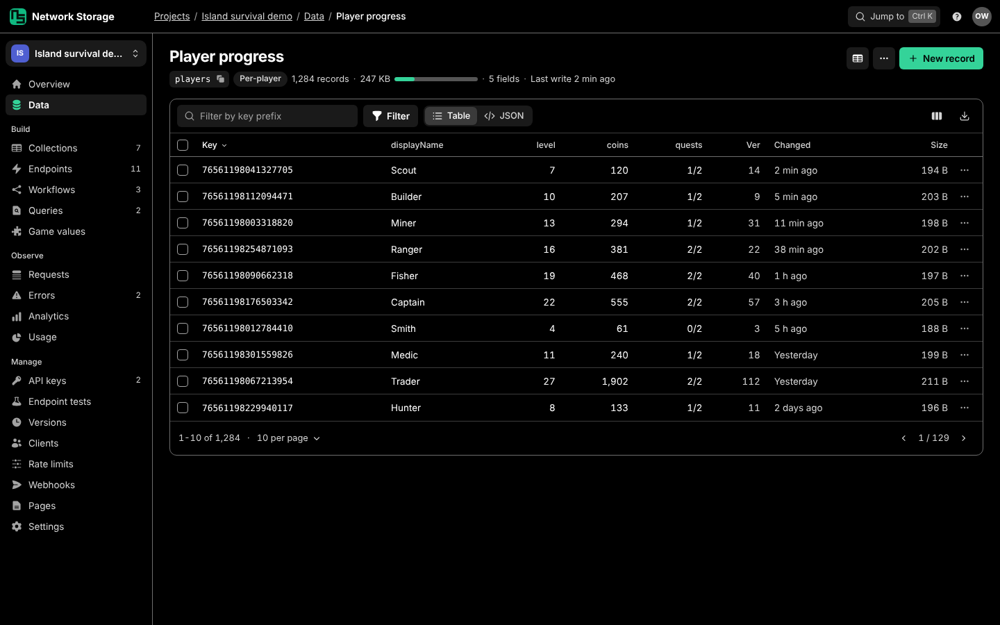 |
|  | 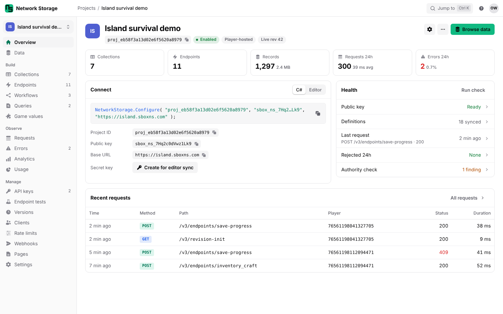 | 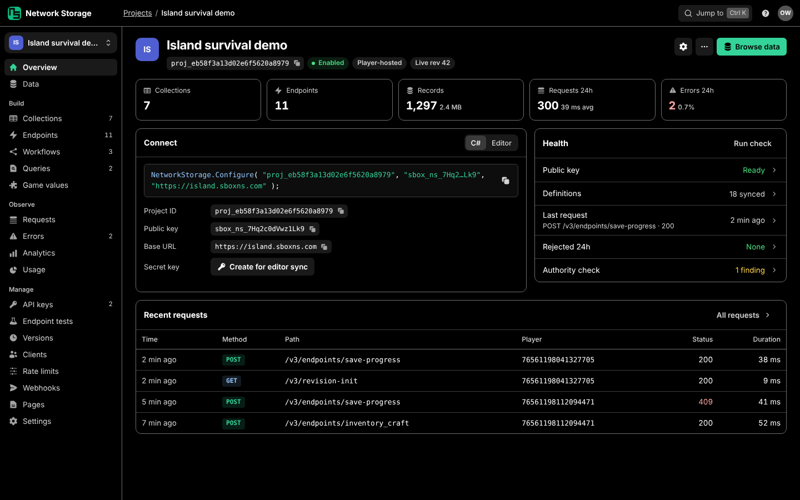 |

The theme picker lives in the owner menu, with Security, Server, Docs, Discord and Log out.

| Owner menu, Dark | Owner menu, Light |
| --- | --- |
| 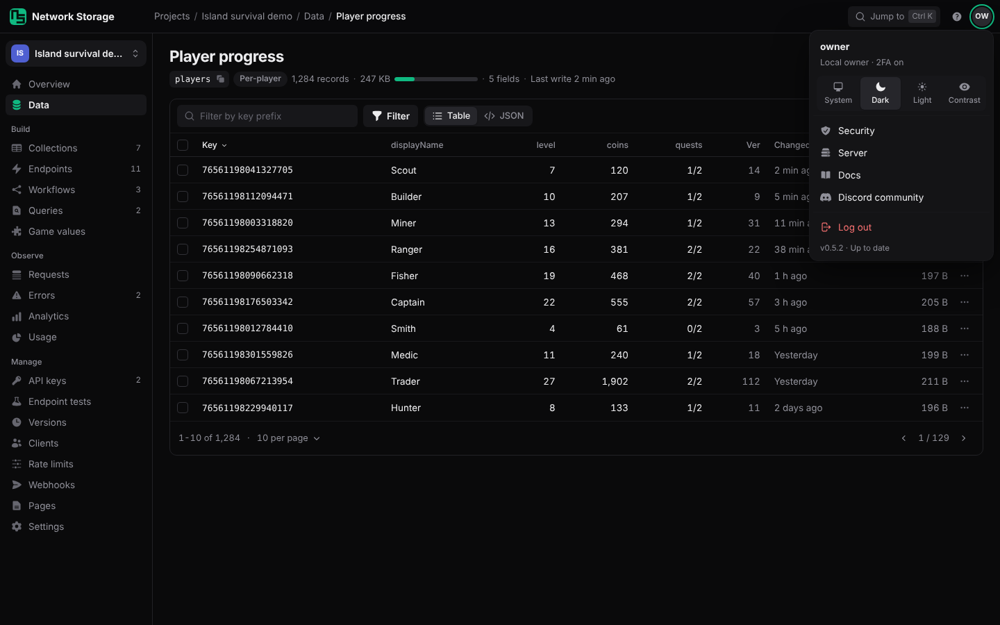 | 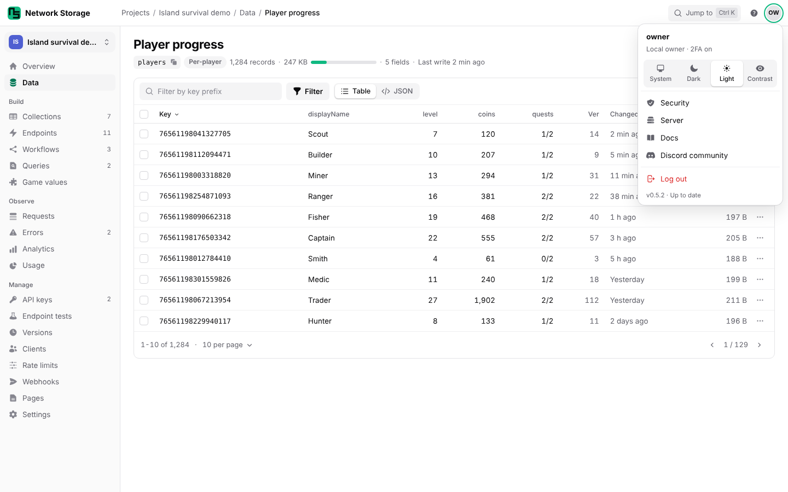 |

### Shell

48px blurred topbar with breadcrumbs, `Ctrl K` jump, guides and the owner menu. 220px sidebar with a project switcher and 30px rows with counts.

### Collection: data first

- Meta line: collection id chip, type, record count, total size with a budget bar, field count, last write.
- Top-level schema fields become columns. A Table / JSON toggle keeps the raw preview one click away.
- 38px rows. Checkbox column, sortable headers, row `...` menu, page size picker.

| Selection and bulk actions | Row menu |
| --- | --- |
|  |  |

### Record: sheet, then page

Clicking a row opens a side sheet with typed fields (Fields / JSON toggle), prev/next, and player shortcuts. Edit goes to the full-page JSON editor. Delete is a confirm modal that keeps the typed-key check.

| Record sheet | Delete confirm |
| --- | --- |
|  |  |

### Project overview

- Header: ID chip, status, hosting, live revision. Settings and `...` are icons; Browse data is the primary action.
- Five stat tiles that link to their pages: collections, endpoints, records with size, requests 24h, errors 24h.
- Connect: the Configure line plus copy chips for project ID, public key and base URL. C# / Editor toggle.
- Health: the current checklist and authority check as one list with status words and drill-in rows.
- Recent requests: last few rows, link to the full log.

### Settings and API keys get their own pages

| Settings (grouped rows, each opens a modal or subpage) | New key modal |
| --- | --- |
|  |  |

### Projects

| List | New project modal | Overflow |
| --- | --- | --- |
|  |  |  |

### Build pages use the same template

### Mobile

| Projects | Overview | Collection | Record | New key |
| --- | --- | --- | --- | --- |
|  |  |  |  |  |

| Light: Overview | Light: Collection | Light: New key |
| --- | --- | --- |
| 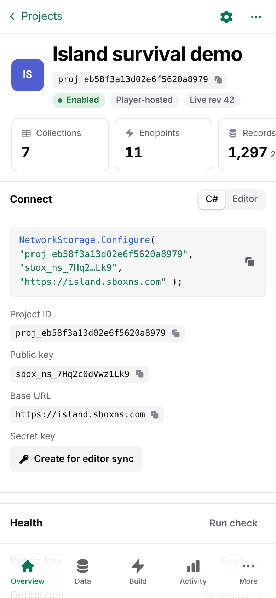 | 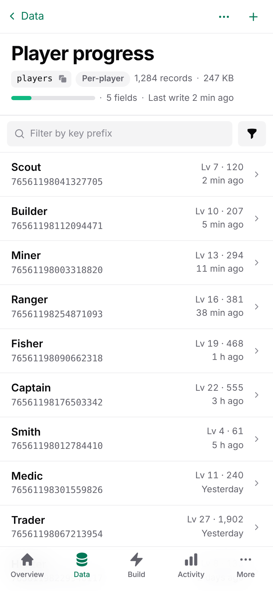 | 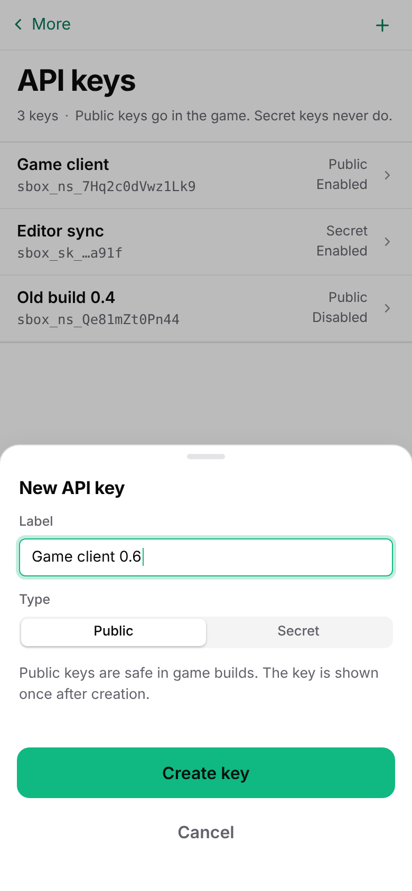 |

### Light theme, other screens

| Record sheet | Settings | New key |
| --- | --- | --- |
| 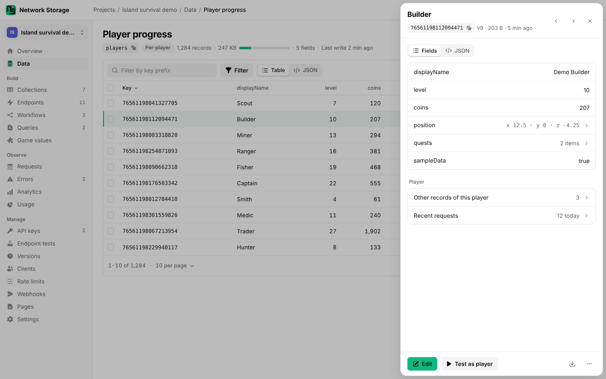 | 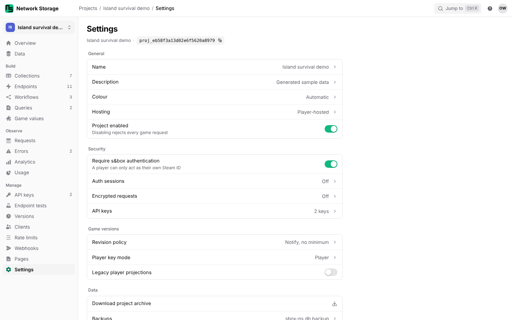 | 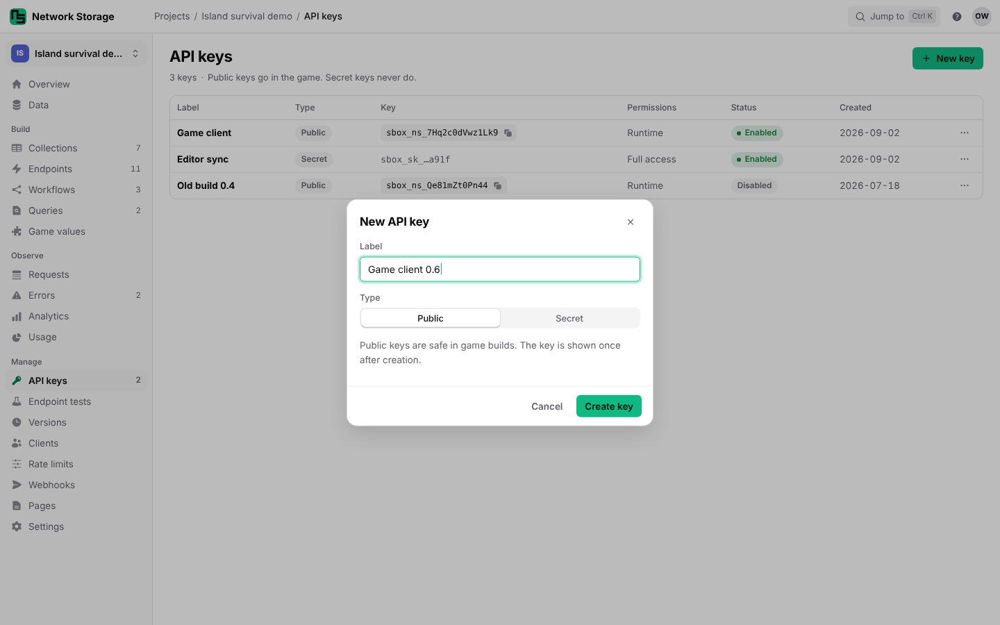 |

### Where today's content goes

| Today | Proposed |
| --- | --- |
| Project settings, security, player keys, projections, revision policy forms | Settings page rows; small sets open a modal, revision policy is a subpage |
| Create key form and per-key permission forms | API keys page; New key modal; Permissions modal from the row menu |
| Checklist table and authority check section | Health list on the overview, drill-in for findings |
| Synced resources buttons and lists | Sidebar and stat tiles |
| Portable archive form | Settings, Data |
| Delete project typed form | Settings, Danger, confirm modal (typed ID kept) |
| Coding agent prompt (project) | Overflow menu: Copy agent prompt |
| Connect a game, Author your first backend, Coding agents (dashboard) | Guides page behind the help icon; shown inline only in the zero-projects empty state |
| Import, Export server buttons | Projects overflow menu |
| Find player form (data browser) | `Ctrl K` jump and the Data page search field |
| Record delete typed form | Record `...` menu, confirm modal |
| Discord link, theme select, version, logout | Owner menu |

### Implementation notes

- No new framework. Native `<dialog>`, `owner-dialog.js` and the `?dialog=` no-JS fallback already exist (`docs/ui-guidelines.md`, Dialogs and toasts); every modal here is a `<dialog>` around a plain POST form. The record sheet's no-JS fallback is the record page.
- Selection and bulk actions are progressive: without JavaScript, row actions stay on the record page. Bulk delete needs a new POST route (version-checked per key, audit-logged). Bulk export can reuse `/export` with a `keys` filter.
- Collection size needs a store aggregate over record sizes. `SizeBytes` is already computed per record.
- Page size: `OwnerDataController.DefaultPageSize` is 50 today, but rows are about 107px, which is why only 4.5 show. At 38px, 1440x900 fits about 16 rows. The mockup shows 10 per page; I recommend 25 as the default with 10/25/50/100 remembered per collection.
- Owner console only. Per `docs/compatibility.md` this needs no s&box editor run; the usual parity, SQLite/PostgreSQL and smoke evidence applies.

### Rollout

1. Design system: replace the theme blocks with the `DESIGN.md` tokens and four themes (with stored-key migration), solid icons, new `docs/ui-guidelines.md`.
2. Shell: topbar with crumbs and owner menu (fixes the Discord bug), sidebar switcher, mobile tab bar.
3. Collection page: schema columns, compact rows, size meta, copy chips, row menu, record sheet.
4. Selection, bulk export, bulk delete route.
5. Project overview: stats, Connect, Health, Recent requests.
6. Settings and API keys pages; remove inline forms from `Project.cshtml`.
7. Projects page and Guides page.
8. Apply the template to Build, Observe and Manage pages.

## Alternatives considered

- **Collapse sections with `
`.** Shorter scroll, same problem: the page still has no single focus, and the forms are still inline.
- **SPA rewrite.** Breaks the no-CDN, offline and no-JavaScript rules for no gain; Razor plus `<dialog>` covers every interaction shown.
- **Inline-editable table cells.** Conflicts with schema validation and version-checked saves. Editing goes through the record editor.

## Client impact

None. Owner console only; no game-facing request or response changes.

Design rules: `docs/proposals/ui-redesign/DESIGN.md`. Mockups: `docs/proposals/ui-redesign/mockup/` (static HTML, open in a browser, resize below 760px for mobile). Mockup data is illustrative, modeled on the demo seed.
